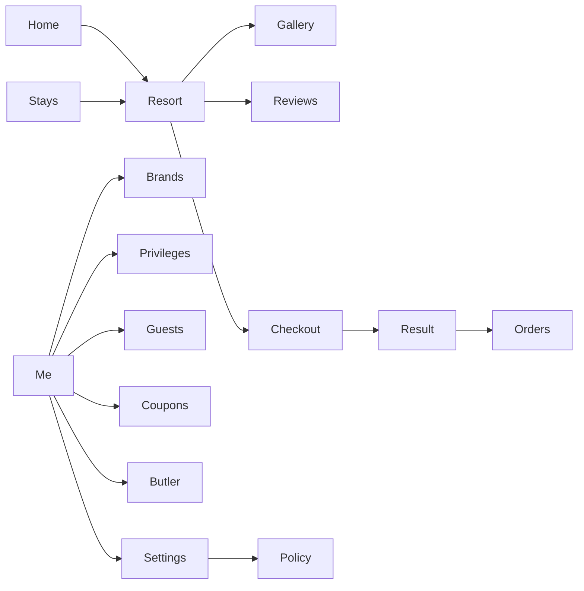

# BookHotel

**QILAN · 栖岚** — a native WeChat Mini Program that lets guests discover boutique mountain and lakeside retreats, pick a room, and complete a booking on their phone.

This is a **full client-side hotel booking product**, not a single list page. It covers the path from brand story → destination search → resort detail → checkout → order history, plus the membership tools that sit around a real stay (saved guests, coupons, a butler thread, house rules).

Sixteen native screens. Four tab destinations. No WebView shell. No third-party UI kit.

[](https://developers.weixin.qq.com/miniprogram/en/dev/framework/)
[](#tech-stack)
[](#screens)
[](#architecture)

---

## What this project is

China’s hotel brands live inside WeChat. Guests do not open a mobile website first — they open a Mini Program from a chat, an official account, or a scan. BookHotel is a **front-end case study of that product**: a luxury-retreat brand (栖岚 / QILAN) with four properties and a complete booking funnel that feels like a shipped consumer app.

The brand is fictional. The **interaction model is real**:

- A guest lands on a home feed of brand lines and featured stays
- They lock a destination, dates, and party size
- They filter the stay list (price, brand, amenity, sort)
- They open a resort, swipe the gallery, read reviews, and pick a room
- They choose who is staying, apply a coupon, and confirm
- The stay appears on the Orders tab and can be revisited

There is no booking server in this repository. Inventory, prices, guests, coupons, and orders live in Mini Program local storage so the whole flow can be demonstrated offline in WeChat DevTools or on a phone. That is a deliberate scope choice: the work is the **product surface and the client architecture**, not a payment integration.

The original design lived in a single HTML file (`qichi-client.html`). This repo is the **native WXML / WXSS / JS restore** of that prototype — same information architecture, same visual language, rebuilt against Mini Program layout rules (custom navigation, capsule-safe headers, `scroll-view`, no WebView).

---

## Who it is for (and why an interviewer might care)

| Audience | What they get from the repo |
| --- | --- |
| Recruiter / hiring manager | A WeChat Mini Program they can skim in five minutes: clear product, real screens, readable README |
| Front-end interviewer | Native Mini Program work: custom nav, custom tab bar, shared store, design tokens, no UI-library shortcut |
| Product-minded interviewer | A booking funnel with empty / sold-out / coupon / guest-missing states, not only the happy path |
| You, in an interview | A concrete story: HTML prototype → native client → local-first state → what you would add next for production |

If you only have two minutes, walk this path:

**Home → a resort card → room → checkout → pay → Orders.**

Then mention one hard Mini Program detail: the custom navigation bar is sized from `getMenuButtonBoundingClientRect`, so titles never collide with the WeChat capsule on different phones.

---

## The product: QILAN

QILAN is positioned as a small luxury collection — not an OTA dump of every hotel in China. Four seeded properties, each with rooms, photo sets, review copy, and a brand line:

| Resort | Place | Brand line | From |
| --- | --- | --- | --- |
| QILAN Moganshan Forest & Hot Spring | Deqing, Zhejiang | 山野 · mountain wild | ¥880 |
| QILAN Dali Shuanglang Waterfront | Erhai, Yunnan | 私汤 · private onsen | ¥1,280 |
| QILAN Huangshan Tangkou Onsen | Tangkou, Anhui | 私汤 · onsen lodge | ¥960 |
| QILAN Qingcheng Daoist Courtyard | Qingchengshan, Sichuan | 院落 · courtyard | ¥1,050 |

A fourth brand line, **美学** (contemporary geometry), lives on the Brands page as a collection story even when it is not the primary stay.

The catalog is written as if a real brand team handed it over: Michelin / Black Pearl style badges, remain-room counts, sold-out Qingcheng, cancellation tags, and stay extras (tea, private onsen, yacht transfer). That copy is what makes the UI feel like a product instead of a CRUD demo.

---

## User journeys

### 1. Book a stay (primary)

1. Open **Home**. Scan brand stories and featured retreats.
2. Jump to **Stays**, or tap a destination chip so the list is already scoped.
3. Adjust dates (check-in / check-out over a 21-day strip) and guest count.
4. Filter by brand, price band, amenity, or sort (default, price, score). Sold-out houses sink to the bottom.
5. Open a resort. Swipe the hero, open the **gallery**, read **reviews**, compare rooms.
6. On **Checkout**, pick a saved guest, optional coupon, arrival note, and stay preferences.
7. Confirm. `doPay` writes an order with status `hold` and sends the guest to **Result**, then **Orders**.

Checkout refuses to complete without a guest — a small validation that is easy to miss in demo apps and easy to talk about in interviews.

### 2. Manage the stay (after booking)

- **Orders** splits bookings with status pills (all / hold / upcoming / past).
- **Me** is the member home: club entry, coupons, butler, settings.
- **Guests** keeps the people who will check in.
- **Coupons** apply a flat amount or a capped rate; the payable total updates before confirm.
- **Butler** is a lightweight message thread (seed + draft), the kind of concierge surface boutique hotels actually ship.
- **Privileges / Policy** explain club benefits and house rules so the brand is not only a shop.

### 3. Browse without committing

Favorites, brand pages, and the gallery are readable without creating an order. Search and filter state stay in the shared store so jumping Home → Stays → back does not reset the guest’s intent.

---

## Screens

Four tabs plus twelve subpages:

| Area | Route | Role |
| --- | --- | --- |
| Home | `pages/home` | Brand stories, featured stays, club entry |
| Stays | `pages/resorts` | Search bar, filters, resort cards |
| Orders | `pages/orders` | Booking list and status pills |
| Me | `pages/me` | Profile and member shortcuts |
| Resort | `pages/resort` | Property detail, rooms, CTA |
| Gallery | `pages/gallery` | Photo set |
| Reviews | `pages/reviews` | Guest quotes and scores |
| Checkout | `pages/checkout` | Guest, coupon, nights, payable |
| Result | `pages/result` | Booking confirmation |
| Brands | `pages/brands` | Four collection stories |
| Privileges | `pages/privileges` | Club benefits |
| Guests | `pages/guests` | Saved check-in names |
| Coupons | `pages/coupons` | Select / inspect offers |
| Butler | `pages/butler` | Concierge thread |
| Settings | `pages/settings` | Preferences |
| Policy | `pages/policy` | House rules |



---

## Architecture

The Mini Program is a **single-process client** with one catalog module and one store.

```text
pages  ──►  utils/store.js  ──►  wx.setStorageSync('qichi-client-v1')
                │
                └──►  utils/data.js   (resorts, rooms, brands, reviews, seed guests / coupons)
```

**Launch.** `app.js` measures the system status bar and the capsule button, then hydrates the store. Every page that draws a custom header reads `navBarHeight` and `capsulePad` so content sits below the status bar and stops before the ••• / capsule cluster.

**Catalog vs. session.** `utils/data.js` owns immutable product data (hotels, rooms, copy). The store owns mutable session data: search dates, filters, selected room, selected guests, selected coupon, favorites, bookings, butler draft.

**Hydrate / persist.** On launch, seed data is loaded and then overlaid with whatever is already on disk. Arrays that must exist (favorites, bookings, guests, coupons) are repaired if storage is partial. A one-shot `fromFlash` flag is stripped before persist so a “just arrived from a deep link / flash entry” hint cannot leak into the next cold start.

**Pricing.** Payable amount is `room.price × nights − coupon`. Coupons are either a flat `amount` (with a minimum spend) or a `rate` capped at ¥200. That logic lives in one place (`couponOff` / `payable`) so Checkout and Result cannot drift.

**Pay.** `doPay` does not call WeChat Pay. It snapshots the selected room, first selected guest, dates, preferences, and payable total into a booking, then prepends it to `bookings`. A production version would replace this function with a server-created order and `wx.requestPayment`.

**Filters.** `filteredResorts()` is a single pipeline: destination lock, brand, area, price band, amenity keywords, marketing tags, then sort. Sold-out properties are not hidden — they sort last, which matches how a real stay list usually behaves.

---

## Engineering notes (the parts that were actually hard)

Mini Program layout is not the browser. This project was used to practice the constraints that break a naive HTML port.

**Custom chrome.** `navigationStyle: custom` plus a `nav-bar` component. Height is `menu.bottom + gap`, and right padding is `windowWidth - menu.left`, so the title and trailing icons never sit under the capsule on iPhone or Android.

**Custom tab bar.** Four branded tabs (Home / Stays / Orders / Me) with a shared `setTabBar` helper so the selected index stays correct when WeChat reuses tab instances.

**Design tokens, not one-off colors.** `app.wxss` defines a Material-style sage palette (`--primary`, `--surface`, `--secondary-container`, serif/sans stacks). Pages consume tokens so the forest-green luxury look stays consistent.

**Icons without a font or image sprite.** `icon-mask` paints CSS-mask SVGs (inline / Base64) so tab and toolbar icons tint with the token color.

**Native-only views.** No Vant, TDesign, or iView. Lists, pills, sheets, and cards are WXML + WXSS. Horizontal status pills use `scroll-view` with `enable-flex` so they do not wrap into a vertical stack — a common Mini Program footgun.

**Prototype kept on purpose.** `qichi-client.html` stays in the tree so a reviewer can compare the SPA and the native app. The Mini Program is not an `<web-view>` of that file.

---

## Tech stack

| Layer | Choice | Why |
| --- | --- | --- |
| Runtime | WeChat Mini Program, base library `3.17.4` | The actual distribution channel for this product type |
| Views | WXML, custom navigation | Pixel control; no H5 chrome |
| Style | WXSS tokens in `app.wxss` | One palette across 16 pages |
| State | `utils/store.js` + `wx.setStorageSync` | Demo-complete without a backend |
| Catalog | `utils/data.js` | Easy to swap for an API later |
| Chrome | `nav-bar`, `custom-tab-bar`, `icon-mask`, `sheet` | Reusable shell |
| Media | Public OSS demo photos | Covers load in DevTools without local assets |

---

## Project layout

```text
BookHotel/
├── app.js / app.json / app.wxss
├── project.config.json
├── qichi-client.html          # original HTML prototype
├── components/
│   ├── nav-bar/               # capsule-aware custom nav
│   ├── icon-mask/             # CSS-mask SVG icons
│   └── sheet/                 # bottom sheet
├── custom-tab-bar/
├── pages/                     # 16 screens
└── utils/
    ├── data.js                # catalog + seed
    ├── store.js               # hydrate / persist / filter / pay
    ├── format.js
    └── icons.js
```

---

## What is in scope vs. out of scope

**In scope (what you can demo today)**

- End-to-end booking UX on WeChat
- Destination / date / guest search
- Resort merchandising (gallery, reviews, badges, remain / sold-out)
- Coupon math and guest validation
- Orders and member-area pages
- Local persistence across restarts

**Out of scope (and what I would add for a production brand)**

| Gap | Production direction |
| --- | --- |
| No login | WeChat `wx.login` + session on a server |
| No real inventory | Availability API; optimistic UI with server truth |
| Mock pay | Prepay order on the server, then `wx.requestPayment` |
| Seed catalog | CMS or admin for rooms, photos, and copy |
| Single-device store | Sync bookings to an account so a new phone still sees them |
| No analytics | Page / funnel events for search → detail → pay |

Being explicit about this split is part of the project: the client is finished enough to critique, and the backend boundary is obvious.

---

## How to run

1. Install [WeChat DevTools](https://developers.weixin.qq.com/miniprogram/en/dev/devtools/download.html).
2. Clone the repo:

   ```bash
   git clone https://github.com/YanHuang545/BookHotel.git
   ```

3. In DevTools, **Import project** and point at this folder (do not open it as a plugin).
4. Use a test AppID or your own. The value in `project.config.json` is a public identifier, not a secret.
5. Compile, then click through Home → resort → checkout → Orders.

To compare design intent, open `qichi-client.html` in a browser. The HTML file is the prototype; the Mini Program is the deliverable.

---

## Talking points for a portfolio review

Use these if someone asks “walk me through a project”:

1. **Problem.** Boutique hotels need a WeChat-native booking surface that feels like the brand, not like a generic OTA.
2. **Constraint.** WeChat is not Chrome. Navigation, scrolling, and text wrapping have to be solved with Mini Program primitives.
3. **Approach.** Design in a single HTML prototype, then rebuild natively with a shared store and tokenized WXSS so sixteen pages stay consistent.
4. **Result.** A guest can complete a stay booking and see it on the Orders tab, with member tools around the edges.
5. **Next.** Replace `doPay` and `data.js` with a real session, inventory, and payment API without rewriting the pages.

---

## Notes

- Seed phones and guest names are fictional.
- Cover images come from a public OSS prefix used only for this prototype.
- Do not commit AppSecret, payment keys, or cloud credentials.

## License

Personal / study project, intended as a portfolio piece. The hotels, prices, and photos are samples — not a live inventory.
