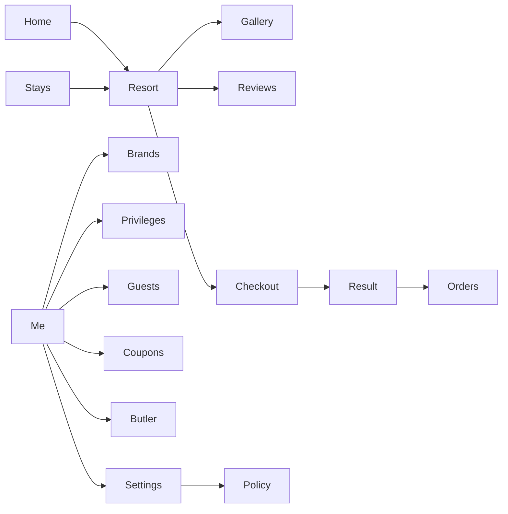

# BookHotel

**QILAN · 栖岚** — a native WeChat Mini Program for boutique mountain and lakeside retreats.

Browse destination resorts, pick a room, walk through checkout, and keep the whole booking on-device. Sixteen screens, four tab destinations, no third-party UI kit.

[](https://developers.weixin.qq.com/miniprogram/en/dev/framework/)
[](#stack)
[](#how-it-works)

---

## Why this exists

Hotel booking UIs on WeChat are usually a pile of list pages and a payment webview. BookHotel is a **product-shaped client**: custom navigation that clears the capsule, a branded tab bar, destination filters, membership, and a butler thread — all in native Mini Program code.

The original single-file HTML prototype (`qichi-client.html`) is kept in the repo as the design source. The Mini Program is a 1:1 native restore, not a WebView wrapper.

## Features

- **Discover** — brand stories, featured stays, and destination chips (Moganshan, Dali, Huangshan, Qingchengshan)
- **Stay** — searchable resort list with badges, remain counts, and sold-out states
- **Book** — room cards, photo gallery, reviews, guest picker, coupons, and a mock checkout
- **Member** — QILAN Club privileges, saved guests, butler messages, and settings
- **Offline-first demo** — bookings, favorites, and coupons persist with `wx.setStorageSync`

## Screens

| Tab | Route | What it does |
| --- | --- | --- |
| Home | `pages/home` | Brands, featured resorts, club entry |
| Stays | `pages/resorts` | Filter, search, resort cards |
| Orders | `pages/orders` | Status pills and booking history |
| Me | `pages/me` | Profile, coupons, butler, settings |

Subpages: resort detail, gallery, reviews, checkout, payment result, brands, privileges, guests, coupons, butler, settings, policy.



## Destinations

Four seeded properties, each with rooms, galleries, and copy in Chinese:

| Resort | Place | From |
| --- | --- | --- |
| QILAN Moganshan Forest & Hot Spring | Deqing, Zhejiang | ¥880 |
| QILAN Dali Shuanglang Waterfront | Erhai, Yunnan | ¥1,280 |
| QILAN Huangshan Tangkou Onsen | Tangkou, Anhui | ¥960 |
| QILAN Qingcheng Daoist Courtyard | Qingchengshan, Sichuan | ¥1,050 |

Brand lines: **山野** mountain wild, **私汤** private onsen, **院落** courtyard, **美学** contemporary.

## Stack

Native Mini Program only. No Vant, no TDesign, no npm UI.

| Layer | Choice |
| --- | --- |
| Runtime | WeChat Mini Program base library `3.17.4` |
| Views | WXML + custom `navigationStyle` |
| Style | WXSS design tokens in `app.wxss` |
| State | `utils/store.js` + local storage key `qichi-client-v1` |
| Catalog | `utils/data.js` (resorts, rooms, brands, reviews, policy) |
| Chrome | `components/nav-bar`, `custom-tab-bar`, `icon-mask`, `sheet` |
| Media | Public OSS covers for the demo photos |

## Project layout

```text
BookHotel/
├── app.js / app.json / app.wxss
├── project.config.json
├── qichi-client.html          # original HTML prototype
├── components/
│   ├── nav-bar/               # capsule-aware custom nav
│   ├── icon-mask/             # CSS-mask SVG icons
│   └── sheet/                 # bottom sheet
├── custom-tab-bar/
├── pages/                     # 16 screens
└── utils/
    ├── data.js                # catalog + seed
    ├── store.js               # hydrate / persist / pay
    ├── format.js
    └── icons.js
```

## How it works

There is no booking backend in this repo. Opening the Mini Program hydrates a seed catalog, then merges anything already saved on the device.

1. `app.js` computes nav chrome from `getMenuButtonBoundingClientRect`
2. `store.hydrate()` loads `utils/data.js` and overlays `wx.getStorageSync('qichi-client-v1')`
3. Checkout writes a booking into that same store
4. `doPay` is a local success path — it does **not** call WeChat Pay

Payment, login, and real inventory would need a server. This project is the client and the interaction model.

## Run it

1. Install [WeChat DevTools](https://developers.weixin.qq.com/miniprogram/en/dev/devtools/download.html)
2. Clone the repo

   ```bash
   git clone https://github.com/YanHuang545/BookHotel.git
   ```

3. **Import** the folder in DevTools (not “open as plugin”)
4. Use a test AppID or your own. The checked-in `project.config.json` AppID is a public identifier, not a secret
5. Compile and preview on the simulator or a phone

Optional: open `qichi-client.html` in a browser to compare the original prototype.

## Notes

- Demo phones and guest names in seed data are fictional
- Cover images are served from a public OSS prefix used only for this prototype
- Do not put AppSecret, payment keys, or cloud credentials in this repository

## License

Personal / study project. If you reuse the UI, keep the demo catalog and photos as samples — they are not a live hotel inventory.
